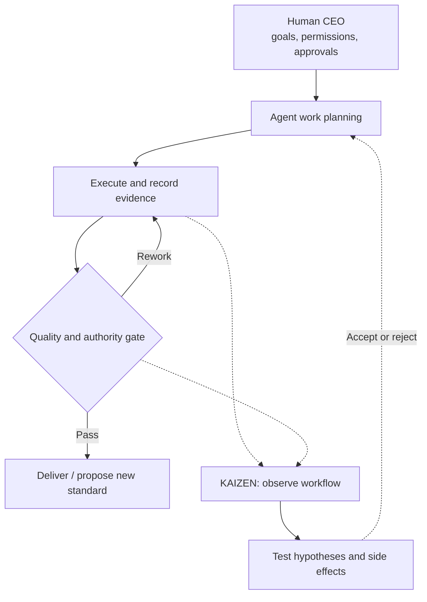

# TOYOTA-style KAIZEN for AI Organizations

**Build an AI-assisted organization that improves how it works, not just what it produces.**

An open-source **Agent Skill + Python CLI** inspired by publicly documented principles of the Toyota Production System (TPS). The human user remains CEO, setting objectives and permission boundaries. AI agents can inspect projects, manage tasks, record decisions, review handoffs, and evaluate process changes within the host's actual permissions.

   

**[日本語 README](README.md)** · [Quick Start](#quick-start) · [Architecture](docs/ARCHITECTURE.md) · [Implementation Status](docs/IMPLEMENTATION-STATUS.md) · [Security](docs/SECURITY.md)

> [!IMPORTANT]
> **Independent, unofficial project.** Not developed, endorsed, certified, or affiliated with Toyota Motor Corporation or Toyota Group. The project independently adapts public TPS concepts. It is not a reproduction of Toyota's internal systems.

## Why this exists

A team of AI agents can finish work while leaving no durable explanation of repeated errors, costly handoffs, blocked tasks, unnecessary checks, or improvement attempts that made things worse.

This toolkit separates the **value stream** (plan → execute → review → deliver) from an **improvement stream** (observe → form a hypothesis → measure → challenge unintended effects). The goal is not more agents or more KAIZEN proposals: it is better outcomes with evidence and manageable coordination costs.



These are **logical responsibilities**, not permanently running separate AI models. A single agent is preferable when multiple agents add no measured value.

## What v1.0.0 supports

| Capability | Available behavior |
| --- | --- |
| Project setup | Install a project-local Skill for Codex, Claude Code, or both |
| First shift | Save a read-only filename inventory and open onboarding task `T0001` |
| Task flow | Dependencies, WIP limits, block/submit/review/rework states |
| Persistent history | Append-only CLI event journal, task board and Markdown observations |
| Bottleneck signals | Inspect recorded queues, blocked tasks and review delays |
| KAIZEN experiments | Record hypotheses, measured before/after values and source files |
| Recovery | Verify journal integrity and rebuild derived files where safe |

The toolkit does not fabricate a universal 100-point organization score. Unmeasured quality stays unmeasured; avoiding unnecessary improvement work is a legitimate outcome.

## Quick Start

**Requirements:** Python 3.10+, an **existing project directory**, and a host agent such as Codex or Claude Code. No third-party Python packages are required.

1. Clone or download this repository; open a terminal in its root directory.
2. Install and initialize the Skill in your existing project:

```bash
python scripts/install.py \
  --target /path/to/your-project \
  --agent codex \
  --write-agent-guide \
  --init \
  --start \
  --mission "Improve delivery quality without increasing rework"
```

Use `--agent claude` or `--agent both` when appropriate. On Windows, you might use `py` instead of `python`. The optional `--write-agent-guide` creates `AGENTS.md` and/or `CLAUDE.md` **only if absent**. Existing Skill installations, `.kaizen` state, and project guidance files are never overwritten by the installer.

3. Open the target project in your AI host and ask:

> Read the installed TOYOTA-style KAIZEN skill. Check `.kaizen/` and the handoff for `T0001`. Inspect the actual project, separate observations from hypotheses, record your findings, and propose the next safe action. Do not perform actions beyond the granted permissions.

4. From the **target project's root**, inspect the state:

```bash
python .agents/skills/toyota-style-kaizen/scripts/kaizen.py status --workspace .
python .agents/skills/toyota-style-kaizen/scripts/kaizen.py next --workspace .
python .agents/skills/toyota-style-kaizen/scripts/kaizen.py diagnose --workspace .
python .agents/skills/toyota-style-kaizen/scripts/kaizen.py doctor --workspace .
```

Replace `.agents/` with `.claude/` for Claude Code. The `start` command creates an initial recorded task and inventory. **It does not invoke an LLM, execute that task, or keep agents running in the background.** Skill discovery and execution depend on the actual host configuration.

## Local memory

```text
<project>/.kaizen/
├── charter.json                      # CEO mission and operating conditions
├── events.jsonl                      # Source-of-truth CLI event journal
├── board.json                        # Derived task and improvement state
├── OPERATING.md                      # Operating rules
├── baseline/startup-inventory.json   # Initial filename inventory
├── handoffs/T0001.md                 # Initial handoff
├── memory/
│   ├── observation.md
│   ├── decision.md
│   ├── risk.md
│   └── lesson.md
└── reports/                         # Reports produced on demand
```

`events.jsonl` records only actions actually sent to the CLI. Other agents' actions are **not passively captured**. `doctor --repair` can rebuild derived files from a valid journal. Hash linking detects accidental corruption, not malicious edits. `.kaizen/` is Git-ignored by default, **not encrypted**: never write API keys, credentials, or unnecessary personal information into its files.

## CEO control and safety

The human CEO defines goals and authorizes sensitive changes. An agent may act as a coordinator, worker, reviewer or KAIZEN observer only within the permissions of its actual host. CLI 'CEO approval' entries are **not identity-verified approvals**; external publication, deletion, payments, outbound communication, and similar high-risk actions must be enforced by the host runtime or a human approval mechanism.

The CLI verifies that submitted evidence paths exist inside the project, but it does **not** establish whether those files are truthful or complete. Measurements are descriptive, not automatically causal. See [Operations](skills/toyota-style-kaizen/references/OPERATIONS.md), [Governance](skills/toyota-style-kaizen/references/ceo-governance.md) and [Security](docs/SECURITY.md).

## What's not implemented

No autonomous multi-model spawning, background jobs, scheduling, automatic external tool telemetry, cost metering, authenticated CEO approvals, self-applying standards, automatic rollback, or production-grade agent E2E validation. This is a **locally tested operating toolkit an AI host can use**, not a complete self-running AI enterprise.

See the [implementation boundaries](docs/IMPLEMENTATION-STATUS.md) before integrating it into sensitive workflows.

## Testing and contributing

```bash
python -m unittest discover -s tests -v
```

**23 tests passed locally** (2026-10-20, Linux / Python 3.13). The GitHub Actions workflow is configured but its results after publication are not yet verified. Real Codex/Claude Code end-to-end trials are not included. Reproducible failures, contrary findings, and negative effects of improvements are welcome. Read [CONTRIBUTING.md](CONTRIBUTING.md) and the [release validation notes](docs/RELEASE-VALIDATION.md).

## Sources and license

Conceptual references: [Toyota Production System](https://global.toyota/en/company/vision-and-philosophy/production-system/) and [Toyota's virtual plant tour](https://global.toyota/en/company/plant-tours/production-system/). Agent packaging follows the [Agent Skills Specification](https://agentskills.io/specification).

Original project code and documentation are distributed under the [MIT License](LICENSE), which grants no rights to Toyota's trademarks, logos or third-party materials.

**Keep what works. Find what doesn't. Improve the improvement process itself.**
