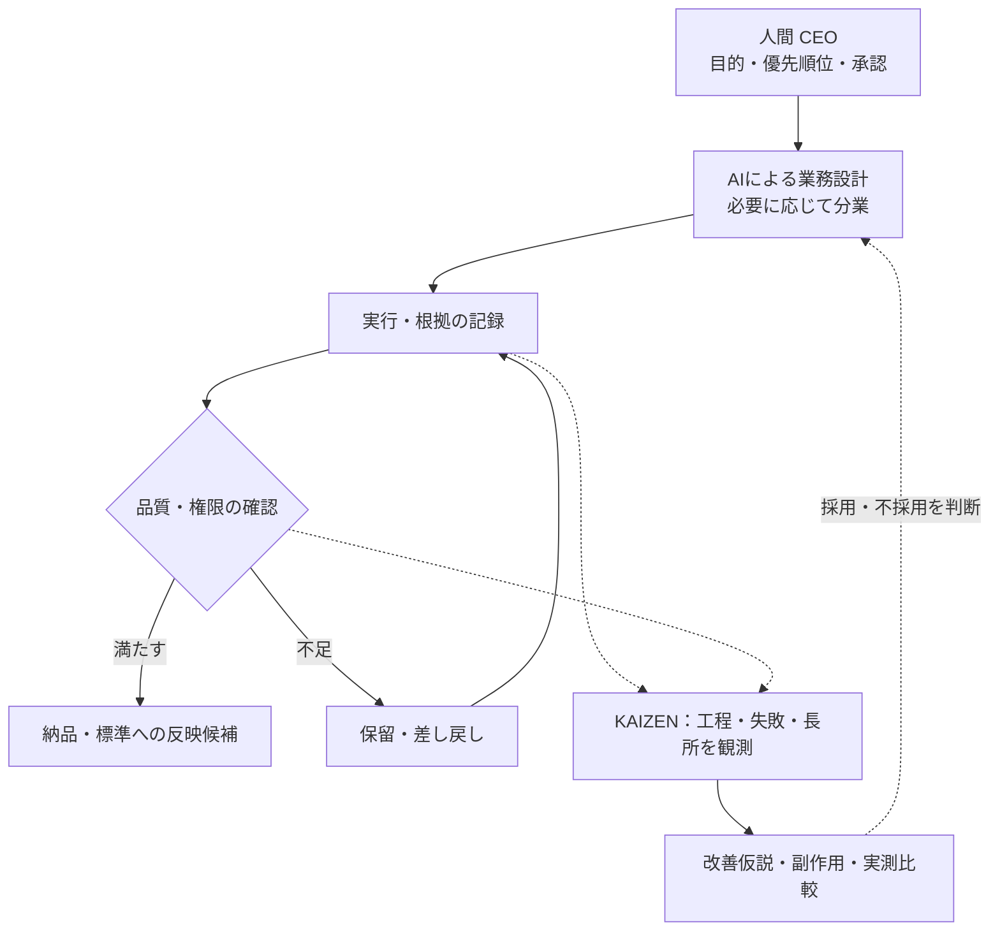

# TOYOTA式 KAIZEN for AI Organizations

**AIに仕事をさせるだけでなく、仕事の進め方を改善できる組織をつくる。**

人間をCEO（社長）として、AIエージェントの仕事・判断・失敗・学習を記録し、工程のムダやボトルネックを見つけるためのオープンソースツールキットです。トヨタ生産方式（TPS）から着想を得た **Agent Skill + Python CLI** で、既存プロジェクトに導入できます。

   

**[English](README.en.md)** · **[導入方法](#quick-start)** · [設計思想](docs/ARCHITECTURE.md) · [機能の実装状況](docs/IMPLEMENTATION-STATUS.md) · [セキュリティ](docs/SECURITY.md)

> [!IMPORTANT]
> **非公式プロジェクトです。** トヨタ自動車株式会社・トヨタグループによる開発、監修、認証、提携はありません。公開されているTPSの考え方をAI組織向けに独自解釈したものであり、トヨタの社内システムを再現したものではありません。

## 何を目指すプロジェクトか

従来のAI活用では、仕事が終わっても「なぜ手戻りが起きたか」「どのエージェント間の引き継ぎが悪かったか」「品質向上のための監査が、かえって作業を遅らせていないか」が残らないことがあります。

TOYOTA式 KAIZENは、**成果物をつくる流れ（Value Stream）** と **組織の仕事の進め方を改善する流れ（Improvement Stream）** を分けて考えます。ユーザーはCEOとして目的と権限を決め、AIは許された範囲で仕事を進め、事実・判断・失敗・改善案をローカルに記録します。



これは**組織の論理モデル**です。図の各役割が別々のAIとして常時起動するわけではありません。簡単な仕事は単一エージェントで処理し、分業の利益が確認できる場合だけ担当を増やす考え方です。

## できること

| 機能 | v1.0.0での動作 |
| --- | --- |
| **初期セットアップ** | Codex / Claude Code向けのプロジェクト内スキル配置、運用状態の作成 |
| **始業** | 実在するファイル名の読み取り専用調査と、初回タスク `T0001` の起票 |
| **業務の進捗管理** | タスクの依存関係、WIP（進行中タスク数）の上限、ブロック、提出、レビュー、差し戻し |
| **組織の記憶** | イベントを `.kaizen/events.jsonl` に記録し、タスク一覧とメモを再生成 |
| **KAIZEN診断** | 停滞、レビュー待ち、WIP超過の兆候などをローカル記録から点検 |
| **改善実験** | 仮説、計測条件、改善前後の値と根拠ファイルを記録・比較 |
| **継続・復旧** | 前回の記録から再開し、ジャーナルの破損検出や派生ファイルの再生成を支援 |

**計測されていない品質を100点と採点したり、改善提案件数を成果として扱ったりはしません。** 良い仕組みも悪い仕組みも検証し、「変更しない」「不要な監査を減らす」という結論を認めます。

## Quick Start

**必要なもの：** Python 3.10以上、既存の作業用プロジェクト、対応するAIエージェント環境（例：CodexまたはClaude Code）。追加のPythonライブラリは不要です。

### 1. リポジトリを取得

GitHubの **Code → Download ZIP** から取得・展開するか、このリポジトリをクローンしてください。以下のコマンドは、**本リポジトリのルート**から実行します。

### 2. AI組織を初期化する

```bash
python scripts/install.py \
  --target /path/to/your-project \
  --agent codex \
  --write-agent-guide \
  --init \
  --start \
  --mission "品質を守りながら、手戻りの少ない開発を続ける"
```

`--target` は**すでに存在するプロジェクトのフォルダ**を指定します。Claude Codeでは `--agent claude`、両方に配置する場合は `--agent both` を指定します。Windowsの場合、環境により `python` の代わりに `py` を使用してください。

この操作でスキルと初期運用データが作られます。`--write-agent-guide` を指定した場合は、Codex向けの `AGENTS.md` またはClaude Code向けの `CLAUDE.md` も生成します。**既存のスキル、運用状態、指示ファイルは上書きせず、導入を中止します。**

### 3. AIエージェントに最初の仕事を依頼する

導入先のプロジェクトをCodexまたはClaude Codeで開き、次のように依頼します。

> TOYOTA式KAIZENのスキルを読み、`.kaizen/` の状態と `T0001` の引き継ぎを確認してください。プロジェクトの実態を調べ、事実と仮説を分けて記録し、次の作業を提案してください。権限外の変更は行わないでください。

`--start` は、ファイル一覧の取得と最初のタスクの開始までを行います。**AIが自動的に実装・修正を完了するコマンドではありません。** 実務の遂行と記録コマンドの呼び出しは、導入先のAI環境が担当します。

### 4. 状態を確認する

Codexへ導入したプロジェクトのルートで実行する例です。

```bash
python .agents/skills/toyota-style-kaizen/scripts/kaizen.py status --workspace .
python .agents/skills/toyota-style-kaizen/scripts/kaizen.py next --workspace .
python .agents/skills/toyota-style-kaizen/scripts/kaizen.py diagnose --workspace .
python .agents/skills/toyota-style-kaizen/scripts/kaizen.py doctor --workspace .
```

Claude Codeの場合は `.agents/` を `.claude/` に読み替えます。導入先ホストのスキル自動検出・利用可否は、その環境の設定に依存します。

## 自動で作成される記録

```text
<your-project>/
├── .agents/skills/toyota-style-kaizen/  # Codex向けスキル（選択時）
├── AGENTS.md                             # 任意：既存なら作成しない
└── .kaizen/
    ├── charter.json                     # CEOの目的・運用条件
    ├── events.jsonl                     # イベントの正本（追記型）
    ├── board.json                       # タスク・改善の最新状態
    ├── OPERATING.md                     # 運用ルール
    ├── baseline/startup-inventory.json  # 初回ファイル一覧の記録
    ├── handoffs/T0001.md                # 最初のタスクへの引き継ぎ
    ├── memory/
    │   ├── observation.md               # 観測した事実
    │   ├── decision.md                  # 意思決定
    │   ├── risk.md                      # リスク
    │   └── lesson.md                    # 学び
    └── reports/                         # 明示的に作成するレポート
```

イベント台帳を正本とし、タスクボードやメモは台帳から再生成できます。`doctor` は記録の整合性を検査し、台帳が正常なら `doctor --repair` によって派生ファイルを復元できます。

`.kaizen/` は標準設定ではGitの追跡対象から除外します。ただし、**Git除外は暗号化でもバックアップでもありません。** APIキー、パスワード、個人情報などを記録しないでください。

## KAIZENで何を見つけるか

| TPSから参考にした考え方 | AI組織での使い方 | 逆効果として検査すること |
| --- | --- | --- |
| 現地現物 | 実ファイルと実行結果から判断 | 推測による架空の問題・数値 |
| 自働化 | 不具合を次工程へ流さない品質ゲート | 過剰な停止・レビュー待ち |
| JIT / WIP制御 | 必要な仕事を適切な順序と量で処理 | API障害時の余力不足、過度な制限 |
| 標準作業 | 再現可能な引き継ぎと受入条件 | 手順の硬直化、探索の阻害 |
| なぜなぜ分析 | 問題の原因仮説を検証する | 「なぜ」を機械的に繰り返す原因の捏造 |
| 横展と改善 | 検証済みの学びを次の仕事に活かす | 局所最適化、過剰な改善活動 |

対象は、文章制作、ソフトウェア開発、調査、複数エージェントの共同作業などです。ただし、各分野の品質保証や専門的判断をこのスキルだけで代替するものではありません。

## 日常運用とCEOの権限

CEOは目標と境界条件を定め、エージェントはホストから実際に与えられた権限内で業務を進めます。役割上の「COO」「品質担当」「KAIZEN担当」は論理的な分担であり、それ自体に新しいツール権限はありません。

```bash
# 観測した事実をメモする
python .agents/skills/toyota-style-kaizen/scripts/kaizen.py memo --workspace . --category observation --task T0001 --text "仕様書と実装との差分を確認した"

# 実在する成果物を証拠として提出する
python .agents/skills/toyota-style-kaizen/scripts/kaizen.py submit --workspace . --task T0001 --result "現状を調査した" --evidence docs/current-state.md

# 実際に内容を確認した担当者がレビューを記録する
python .agents/skills/toyota-style-kaizen/scripts/kaizen.py review --workspace . --task T0001 --decision accept --reason "根拠ファイルと受入条件を照合した"
```

上の `docs/current-state.md` は**利用者が実際に作成する成果物の例**で、最初から存在するわけではありません。CLIはファイルの存在・配置などは検査しますが、証拠の内容が正しいことまでは自動で証明しません。

また、CLIのCEO承認記録は**本人認証ではありません**。外部への公開、課金、削除、送信などの高リスク操作は、Codex・Claude Code等の実行環境側で許可や人間の確認を強制してください。自律稼働と安全上の責任をREADMEの宣言だけで成立させることはできません。

詳しくは [運用リファレンス](skills/toyota-style-kaizen/references/OPERATIONS.md)、[CEO権限設計](skills/toyota-style-kaizen/references/ceo-governance.md)、[セキュリティ](docs/SECURITY.md) を参照してください。

## v1.0.0の実装範囲

**現在できること：** ローカル初期化、始業記録、タスクの状態管理、明示的なメモ、測定値の保存、実測差分の計算、整合性検査と一部復旧。

**まだできないこと：** 複数LLMの自動起動、24時間のバックグラウンド運営、スケジューリング、外部ツールの利用履歴の自動収集、実際の利用料金の取得、認証済みのCEO承認、自動ロールバック、実環境での品質保証。

**v1.0.0は「AIが使えるローカル運用基盤」であり、無人で自律運営されるAI企業ではありません。** 対応ホストに加え、継続稼働には別途オーケストレーションやスケジューラが必要です。実装と計画の区別は [実装状況](docs/IMPLEMENTATION-STATUS.md) にまとめています。

## テストと貢献

リポジトリのルートで実行します。

```bash
python -m unittest discover -s tests -v
```

公開パッケージのローカル検証では**23件のPythonテストが成功**しています（2026-10-20、Linux / Python 3.13）。GitHub Actionsでも同じテストを実行する設定があります。ただし、実際のCodex / Claude Codeにおける一連のAI業務を検証したE2Eテスト、および公開後のGitHub Actions稼働結果は未確認です。

不具合報告、失敗事例、反証、使いにくい工程の指摘も歓迎します。改善案には「直した結果」だけでなく、「何を比較したか」「何が悪化する可能性があるか」を添えてください。手順は [CONTRIBUTING.md](CONTRIBUTING.md)、検証範囲は [RELEASE-VALIDATION.md](docs/RELEASE-VALIDATION.md) に記載しています。

## 参考資料・ライセンス

TPSの考え方は、トヨタ自動車が公開している [トヨタ生産方式](https://global.toyota/jp/company/vision-and-philosophy/production-system/) と [バーチャル工場見学](https://global.toyota/jp/company/plant-tours/production-system/) を参照しています。Agent Skillの記述形式は [Agent Skills Specification](https://agentskills.io/specification) を参考にしています。

本リポジトリの独自コード・文書は [MIT License](LICENSE) で配布します。トヨタ自動車および第三者が保有する名称・ロゴ・著作物の利用許諾を意味しません。

**良い工程は残す。悪い工程は見つける。改善活動そのものも、改善対象にする。**